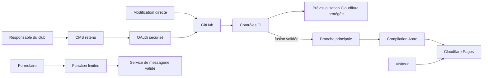
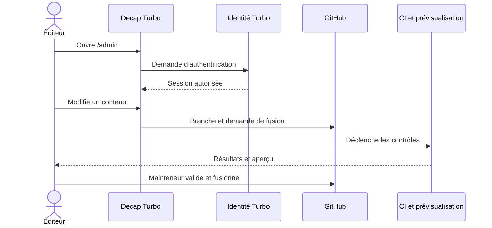
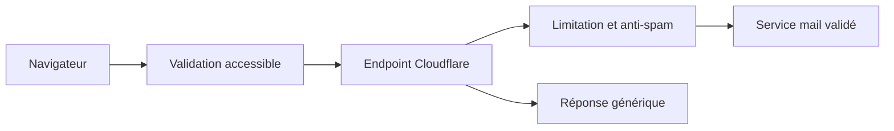
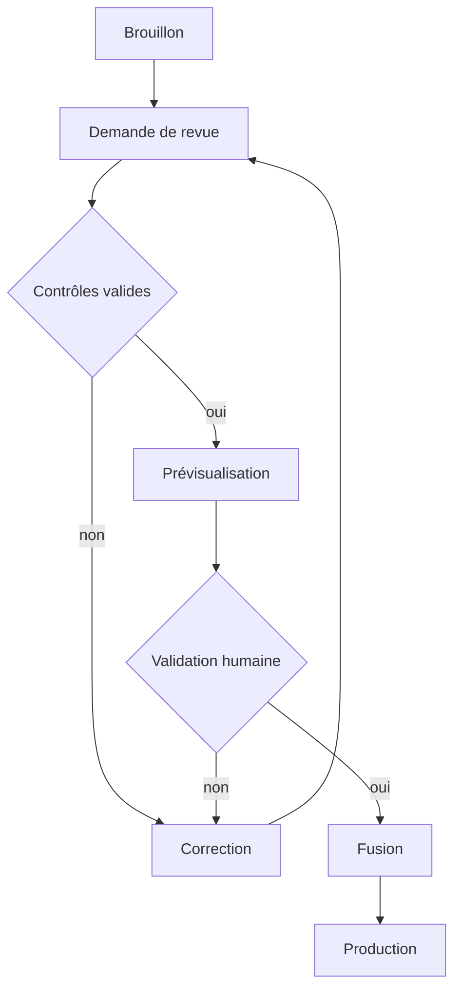

# Architecture proposée — VAN THUYNE TAEKWONDO / ELITE

**Version :** conception de Phase 1, 5 novembre 2026  
**Statut :** proposition, aucune implémentation engagée

## 1. Objectifs d’architecture

L’architecture doit privilégier :

1. la simplicité pour les responsables du club ;
2. la fiabilité et la sécurité ;
3. un coût récurrent nul ou faible ;
4. la portabilité des contenus ;
5. de bonnes performances ;
6. un bilinguisme explicite ;
7. des données sportives vérifiables ;
8. une évolution possible sans réécriture complète.

Elle ne doit pas introduire de base de données, de serveur permanent ou de
microservice sans besoin démontré.

## 2. Décisions proposées


### ADR-001 — Génération statique avec Astro

**Décision proposée :** Astro en sortie statique.

**Pourquoi :**

- le contenu change moins souvent qu’il n’est consulté ;
- la majorité des pages ne nécessite pas de session visiteur ;
- les performances et le cache sont excellents ;
- la surface d’attaque est réduite ;
- Astro permet des composants interactifs ciblés sans application JavaScript
complète côté navigateur.

**Alternative :** rendu serveur permanent.  
**Rejet provisoire :** complexité et coût inutiles pour les besoins connus.

### ADR-002 — Git comme source de vérité

**Décision proposée :** tous les contenus publiables vivent dans des fichiers
versionnés dans un dépôt privé.

**Pourquoi :**

- historique complet ;
- revue avant publication ;
- restauration simple ;
- édition graphique et édition directe sur les mêmes données ;
- absence de verrouillage dans une base propriétaire.

**Limite :** Git ne fournit pas de verrouillage sémantique. Les conflits doivent
être prévenus et gérés. Son historique conserve aussi les suppressions : aucune
donnée personnelle non autorisée ni preuve d’autorisation ne doit y entrer.

**Alternative :** base de contenu gérée par un CMS headless.  
**Avantage de l’alternative :** permissions et verrouillage potentiellement plus
fins.  
**Inconvénients :** service supplémentaire, export, sauvegarde, coût et risque
de dépendance.  
**Conséquence de maintenance :** Git demande une discipline de branches et de
revue ; le CMS headless demanderait en plus l’exploitation d’une base et de son
API.

### ADR-003 — CMS pour 5 à 6 comptes

**Décision proposée :** conserver deux scénarios jusqu’à validation du niveau
de permissions :

- Decap Turbo avec rôles avancés si les restrictions par collection sont
  obligatoires ;
- Pages CMS hébergé si un accès éditorial large est acceptable pour préserver
  un coût CMS nul.

**Pourquoi :**

- les deux solutions conservent Git comme source canonique ;
- Decap apporte i18n, brouillons et workflow éditorial, mais ses permissions
  fines et cinq à six sièges sont payants ;
- Pages CMS simplifie les comptes sans abonnement annoncé, mais ne fournit ni
  permissions par collection ni workflow de validation comparable.

**Condition :** choisir le scénario avant la Phase 3 et tester
authentification, révocation, concurrence, aperçu et publication. Le backend
GitHub standard de Decap n’est pas recommandé par défaut pour six éditeurs,
car il accorde un accès d’écriture étendu au dépôt.

### ADR-004 — Cloudflare Pages

**Décision proposée :** Cloudflare Pages pour la production et les
prévisualisations.

**Pourquoi :**

- hébergement statique à faible coût ;
- domaine et HTTPS ;
- prévisualisations de branches ;
- en-têtes et redirections configurables ;
- fonction légère possible pour OAuth et contact.


### ADR-005 — Données sportives normalisées

**Décision proposée :** compétitions, résultats et athlètes sont des entités
distinctes, reliées par identifiants stables.

**Pourquoi :**

- évite de recopier un athlète dans chaque compétition ;
- facilite les filtres et les agrégats ;
- permet de valider chaque résultat ;
- évite le double comptage.

**Alternative :** imbriquer tous les résultats dans chaque compétition.  
**Avantage de l’alternative :** saisie en un seul formulaire.  
**Inconvénients :** fichiers volumineux, conflits plus fréquents, relations et
réutilisation moins claires.  
**Coût et maintenance :** la normalisation ajoute des sélections relationnelles
dans le CMS, mais simplifie les tests, filtres et corrections sur le long terme.

### ADR-006 — Faits communs, textes localisés

**Décision proposée :** les faits sportifs ne sont stockés qu’une fois. Les
champs éditoriaux FR et EN sont séparés et appariés.

**Pourquoi :**

- une date ou une médaille ne dépend pas de la langue ;
- une correction factuelle s’applique aux deux sites ;
- les traductions peuvent évoluer indépendamment.

**Alternative :** dupliquer chaque entrée complète dans un dossier par langue.  
**Avantage de l’alternative :** correspond directement au mode
`multiple_folders` de Decap.  
**Inconvénients :** dates, lieux, classements et relations peuvent diverger.  
**Coût et maintenance :** les blocs localisés demandent une configuration CMS
plus explicite, mais évitent les doubles corrections factuelles.

## 3. Vue d’ensemble




Le site public reste statique. Le broker OAuth et le traitement du formulaire
sont les seules fonctions serveur envisagées. Elles sont isolées et justifiées
par un besoin précis.

## 4. Couches du système


### 4.1 Présentation

- layouts Astro ;
- composants accessibles et réutilisables ;
- CSS moderne et design tokens ;
- composants interactifs uniquement pour menu, filtres et galeries ;
- intégration YouTube différée.


### 4.2 Routage et internationalisation

- routes sous `src/pages/[lang]/` ;
- langues autorisées `fr` et `en` ;
- français par défaut ;
- fonctions centralisées de génération d’URL ;
- correspondance entre pages traduites ;
- canonical et hreflang générés depuis les mêmes métadonnées.


### 4.3 Contenu

- Content Collections Astro ;
- schémas stricts ;
- fichiers Markdown/MDX pour les articles longs ;
- YAML ou JSON pour les données sportives structurées ;
- fichiers appariés ou objets localisés selon le type de contenu.


### 4.4 Métier

- résolution des relations par identifiants ;
- calcul du palmarès ;
- tri et filtres ;
- sélection des contenus publiés ;
- contrôle des traductions ;
- génération des métadonnées SEO.

Cette logique reste indépendante des composants d’affichage.

### 4.5 Publication

- CMS Git-based retenu ;
- GitHub ;
- CI ;
- prévisualisation ;
- compilation de production ;
- Cloudflare Pages.


## 5. Organisation des contenus


### 5.1 Collections structurées

`club`

- identité publique ;
- histoire ;
- valeurs ;
- lieux ;
- encadrement autorisé ;
- coordonnées ;
- textes localisés.

`athletes`

- profil public optionnel ;
- disciplines ;
- catégorie ;
- textes localisés ;
- média autorisé ;
- statut.

`competitions`

- identité, dates, lieu et niveau ;
- disciplines ;
- participants ;
- médias et vidéos ;
- textes localisés ;
- statut.

`results`

- relation compétition ;
- athlète, paire ou équipe ;
- discipline ;
- classement et médaille ;
- détails spécifiques ;
- statut.

`news`

- article FR ou EN ;
- clé de traduction ;
- catégorie ;
- dates ;
- galerie ;
- relations facultatives.

`events`

- dates et lieu communs ;
- horaires ISO et identifiant de fuseau IANA lorsqu’une heure est publiée ;
- contenus FR/EN ;
- discipline ;
- lien externe ;
- statut.

`galleries`

- titre et description localisés ;
- liste de médias ;
- crédits et droits ;
- relation compétition ou événement.

`videos`

- identifiant YouTube ;
- titre et description localisés ;
- miniature ;
- relations ;
- statut.


### 5.2 Stratégie de fichiers

Les données sportives privilégient un fichier par entité :

```text
src/content/
├── athletes/
│   └── athlete-<id>.yaml
├── competitions/
│   └── competition-<id>.yaml
├── results/
│   └── result-<id>.yaml
├── news/
│   ├── fr/
│   └── en/
├── events/
│   └── event-<id>.yaml
├── galleries/
└── videos/
```

Les noms illustrent une convention ; aucun identifiant réel n’est proposé.

### 5.3 Forme des traductions

Pour les données sportives, un seul fichier contient les faits communs et deux
blocs éditoriaux. Cette collection n’utilise pas le mode Decap
`multiple_folders` : le formulaire affiche explicitement les groupes français
et anglais.

```yaml
id: competition-<id>
startDate: YYYY-MM-DD
location: <valeur officielle>
status: draft
translations:
  fr:
    status: draft
    name: <titre validé>
    summary: <texte validé>
  en:
    status: draft
    name: <validated title>
    summary: <validated text>
```

Pour une actualité longue, deux fichiers Markdown peuvent être liés par une
`translationKey`. Cette collection peut utiliser le mode
`multiple_folders` de Decap. Cela évite un fichier difficile à éditer et permet
des dates de validation indépendantes sans dupliquer les faits sportifs.

### 5.4 Statuts

Le statut global utilise un enum unique :

- `draft` : caché et exclu des agrégats ;
- `published` : visible et pris en compte dans les agrégats applicables ;
- `archived` : accessible uniquement comme historique administratif et exclu
  du palmarès public ;
- `cancelled` : visible comme annulé uniquement pour une compétition ou un
événement, jamais pris en compte dans le palmarès.

Chaque bloc de traduction utilise séparément `missing`, `draft`, `validated` ou
`published`. Une page localisée n’est générée que si le statut global permet la
publication et si la traduction de cette langue est `published`.

Par défaut, la CI exige les traductions FR et EN publiées avant de rendre
l’entité publique. Une exception de repli doit être explicite, documentée et ne
crée jamais une traduction automatique.

Le statut Git du workflow et le statut métier du contenu sont distincts. Un
fichier présent sur la branche principale peut rester en brouillon et être
exclu du site public. Un brouillon Git ne doit toutefois contenir que des
informations déjà autorisées à être stockées dans le dépôt privé.

## 6. Modèle de données


### 6.1 Competition

Champs communs :

- `id` : identifiant immuable ;
- `slug` : fragment d’URL stable ;
- `startDate` ;
- `endDate` facultative ;
- `startDateTime` et `endDateTime` facultatifs pour un horaire précis ;
- `timeZone` IANA obligatoire lorsqu’un horaire est présent ;
- `location` structuré ;
- `level` contrôlé ;
- `disciplines` : une ou plusieurs valeurs ;
- `registeredEntrantIds` facultatif pour les inscrits annoncés avant résultat ;
- `galleryIds` ;
- `videoIds` ;
- `status` ;
- `translations.fr` ;
- `translations.en`.

Contraintes :

- `startDate <= endDate` ;
- au moins une discipline ;
- identifiants référencés existants ;
- tous les athlètes d’un résultat appartiennent aux inscrits si
`registeredEntrantIds` est renseigné ; sinon les participants historiques
sont dérivés des résultats ;
- slug unique ;
- traductions validées avant publication selon la politique retenue.


### 6.2 Athlete

Champs :

- `id` ;
- `displayName` ;
- `disciplines` ;
- `sportCategory` ;
- `profileVisibility` ;
- `photo` facultative ;
- `translations` ;
- `status`.

La date de naissance, l’adresse, le numéro de licence et les coordonnées privées
ne sont pas stockés dans le site.

Une référence interne non sensible d’autorisation peut être conservée, mais pas
le document d’autorisation lui-même dans un dépôt Git, même privé.

### 6.3 Result

Champs communs :

- `id` ;
- `competitionId` ;
- `discipline` : `combat` ou `poomsae` ;
- `participantType` : `individual`, `pair` ou `team` ;
- `athleteIds` ;
- `rank` : entier positif ou absence de classement ;
- `medal` : `gold`, `silver`, `bronze` ou `none` ;
- `status` ;
- `summary.fr` et `summary.en` facultatifs ;
- `details` discriminé par discipline.

Contraintes :

- Combat utilise uniquement un participant individuel tant que le règlement du
club ne nécessite pas un autre cas ;
- une paire Poomsae contient deux athlètes ;
- une équipe contient un nombre validé d’athlètes ;
- `medal: gold` implique normalement `rank: 1` ;
- `medal: silver` implique normalement `rank: 2` ;
- `medal: bronze` accepte le ou les classements définis par le règlement de la
compétition ;
- les exceptions exigent une justification structurée, pas une correction
silencieuse.


### 6.4 Détails Combat

- catégorie de poids sous forme de valeur contrôlée et libellé ;
- catégorie d’âge ;
- résumé facultatif ;
- éventuels champs supplémentaires uniquement après validation métier.

Le poids exact d’un athlète n’est pas nécessaire : seule la catégorie publiée
est stockée.

### 6.5 Détails Poomsae

- type de participation ;
- catégorie ;
- composition par identifiants d’athlètes ;
- résumé facultatif.

L’équipe est portée par le résultat. Une entité d’équipe permanente ne sera
créée que si le club en a réellement besoin.

## 7. Palmarès et agrégats


### 7.1 Source

Tous les chiffres sont dérivés de `results` et `competitions`. Aucun total
éditorial n’est accepté.

### 7.2 Algorithme conceptuel

1. Charger uniquement les résultats `published`.
2. Valider l’unicité de `result.id`.
3. Résoudre la compétition et les athlètes.
4. Écarter toute référence invalide.
5. Grouper par discipline, saison ou athlète selon la vue.
6. Compter chaque résultat une seule fois.
7. Compter la médaille selon la valeur normalisée.
8. Compter les compétitions par identifiant distinct.


### 7.3 Règles

- Une médaille d’équipe représente un résultat et une médaille club.
- Une participation d’équipe représente un résultat sportif.
- Une vue « participations d’athlètes » peut compter chaque membre séparément,
mais doit porter un nom distinct.
- Un résultat sans médaille peut compter comme participation et classement.
- Un résultat en brouillon, annulé ou archivé ne contribue à aucun chiffre
  public.
- Un résultat archivé reste consultable dans l’historique administratif.
- Une modification déclenche le recalcul lors de la compilation.


### 7.4 Tests attendus

- doublon d’identifiant rejeté ;
- même résultat référencé deux fois compté une fois ou rejeté ;
- changement de médaille reflété dans tous les agrégats ;
- résultat archivé exclu des totaux publics ;
- équipe comptée selon la règle validée ;
- séparation Combat/Poomsae correcte ;
- saisons aux limites de dates testées.


## 8. Architecture bilingue


### 8.1 Routes

```text
/fr/
/fr/club/
/fr/disciplines/combat/
/fr/disciplines/poomsae/
/fr/athletes/
/fr/competitions/
/fr/competitions/[slug]/
/fr/resultats/
/fr/palmares/
/fr/calendrier/
/fr/actualites/
/fr/medias/photos/
/fr/medias/videos/
/fr/contact/
/en/
/en/club/
/en/disciplines/combat/
/en/disciplines/poomsae/
/en/athletes/
/en/competitions/
/en/competitions/[slug]/
/en/results/
/en/honours/
/en/calendar/
/en/news/
/en/media/photos/
/en/media/videos/
/en/contact/
```


### 8.2 Dictionnaires d’interface

Les libellés de navigation, filtres, erreurs et boutons vivent dans des
dictionnaires TypeScript validés. La CI vérifie que les deux langues possèdent
les mêmes clés.

### 8.3 Contenu éditorial

- traduction humaine ;
- état de validation par langue ;
- prévisualisation FR et EN ;
- clé de traduction commune ;
- aucune publication automatique issue d’une traduction machine.


### 8.4 Sélecteur de langue

Le sélecteur :

- conserve la destination équivalente si elle existe ;
- revient à l’accueil de l’autre langue seulement si aucune correspondance
n’est disponible et si cette politique est validée ;
- indique la langue courante ;
- fonctionne au clavier ;
- ne dépend pas d’un cookie pour les liens explicites.


## 9. Administration et rôles


### 9.1 Parcours avec permissions fines



Avec Pages CMS, le collaborateur s’authentifie auprès du service puis enregistre
directement sur la branche configurée. Les brouillons métier restent possibles
par champ de statut, mais la branche, la revue et l’approbation doivent être
ajoutées par convention ou automatisation. Ce scénario ne doit pas être décrit
comme équivalent au workflow éditorial Decap.


### 9.2 Limite importante des droits GitHub

Le backend GitHub standard de Decap demande un droit d’écriture au dépôt. GitHub
ne fournit pas nativement de permissions d’écriture limitées à certains
dossiers pour ce cas.

La branche protégée empêche une publication directe, mais elle n’interdit pas à
un éditeur techniquement capable de proposer une modification de code.

Pour un dépôt privé, le backend OAuth GitHub peut demander la portée large
`repo`. Le jeton est ensuite utilisé par Decap dans le navigateur. Il ne faut
donc pas le présenter comme un jeton strictement limité au contenu. Les comptes
éditeurs ne doivent avoir accès à aucun autre dépôt sensible ; le prototype
d’authentification devra vérifier la portée réelle et le cycle de vie du jeton.

Pour 5 à 6 personnes, le backend GitHub standard n’est donc pas recommandé par
défaut. Decap Turbo réduit l’exposition grâce à une GitHub App limitée au dépôt,
mais synchronise le contenu dans sa base et facture les sièges/rôles. Pages CMS
utilise également une GitHub App limitée au dépôt, sans fournir de droits par
collection.

### 9.3 Rôles métier proposés

**Administrateur principal**

- gère les accès, services, facturation et récupération ;
- possède le rôle mainteneur GitHub ;
- peut fusionner, restaurer et traiter les incidents.

**Administrateur sportif**

- gère athlètes, compétitions, résultats, palmarès et contenus des disciplines ;
- ne gère pas les comptes, secrets ou paramètres du service.

**Administrateur éditorial**

- gère pages, actualités, événements, médias et contenus FR/EN ;
- consulte les collections sportives nécessaires.

**Contributeur**

- crée et modifie uniquement les contenus autorisés ;
- charge les médias autorisés ;
- prépare une publication selon ses droits ;
- ne gère pas les secrets ni le domaine.

Cette séparation est techniquement applicable avec les rôles avancés Turbo.
Dans Pages CMS, elle devient une règle organisationnelle non garantie par le
service. Les rôles Turbo `edit/view/none` ne suffisent pas à distinguer
approbateur et publieur : une revue GitHub par mainteneur reste requise.

## 10. Médias


### 10.1 Pipeline

- originaux conservés dans un espace privé maîtrisé ;
- version web importée avec limite de poids ;
- métadonnées de crédit et droits ;
- optimisation Astro ;
- AVIF/WebP avec JPEG/PNG de repli si nécessaire ;
- largeur et densité adaptées ;
- chargement différé hors premier écran.


### 10.2 Politique de dépôt

- aucune vidéo auto-hébergée sans justification ;
- images web uniquement dans Git ;
- originaux haute définition hors de tout dépôt Git ;
- taille maximale à définir après test ;
- noms de fichiers stables, descriptifs et sans données sensibles ;
- suppression logique et procédure de retrait documentée.


### 10.3 YouTube

- stockage de l’identifiant vidéo, pas du code d’intégration arbitraire ;
- miniature locale ou approuvée ;
- lecteur chargé sur action ou proximité d’affichage ;
- mode respectueux de la vie privée lorsque disponible ;
- lien direct toujours accessible.


## 11. Formulaire de contact


### 11.1 Architecture proposée




### 11.2 Exigences

- méthode POST ;
- contrôle serveur ;
- origine autorisée ;
- taille maximale ;
- limitation de débit ;
- champ piège ;
- Turnstile ou mécanisme équivalent si nécessaire ;
- messages sans fuite d’information ;
- journalisation minimale ;
- durées de conservation et procédure de suppression définies pour la
Function, ses journaux, les files du fournisseur, le service d’envoi et la
boîte de réception finale.


### 11.3 Décision différée

Le fournisseur d’envoi n’est pas choisi en Phase 1. La décision dépend de :

- l’adresse destinataire ;
- la localisation du traitement ;
- l’accord de traitement des données ;
- les quotas ;
- le coût ;
- la délivrabilité ;
- la possibilité d’export et de suppression.


## 12. Sécurité


### 12.1 Menaces principales

- prise de contrôle d’un compte éditeur ;
- fuite d’un secret OAuth ;
- modification malveillante du contenu ;
- publication de données ou médias non autorisés ;
- injection par contenu riche ;
- spam du formulaire ;
- dépendance compromise ;
- mauvaise configuration DNS ;
- exposition de prévisualisations.


### 12.2 Mesures

**Identité et accès**

- comptes nominatifs ;
- 2FA ;
- pas de compte partagé ;
- accès révoqué immédiatement au départ d’un responsable ;
- revue périodique des membres.

**Git et CI**

- dépôt privé ;
- branche principale protégée ;
- contrôles requis ;
- revue obligatoire et contournement réservé au compte d’urgence documenté ;
- CODEOWNERS pour configuration, sécurité et workflows ;
- commits et historique conservés ;
- secrets détectés.

**OAuth**

- secret dans l’environnement Cloudflare ;
- validation du paramètre `state` ;
- origines et redirections en liste blanche ;
- portée minimale réellement compatible avec le backend ; le risque de la
portée `repo` est documenté si elle est exigée ;
- jeton utilisé dans le navigateur considéré comme donnée sensible ;
- aucune valeur sensible dans les logs ;
- rotation documentée.

**Contenus**

- Markdown rendu avec une politique sûre ;
- HTML arbitraire interdit par défaut ;
- URLs validées ;
- fichiers limités par type et taille ;
- aucun nom de fichier fourni directement au système sans normalisation.

**Site**

- CSP testée ;
- HSTS après validation HTTPS ;
- refus du sniffing MIME ;
- politique de référent restrictive ;
- permissions navigateur minimales ;
- sous-ressources externes limitées.
- prévisualisations privées protégées par Cloudflare Access ;
- en-têtes de sécurité ajoutés dans chaque Function, car `_headers` ne
s’applique pas à leurs réponses ;
- procédure de retrait d’urgence : suppression de la source, réécriture
contrôlée de l’historique si indispensable, purge des caches et révocation
des URLs de prévisualisation.


## 13. SEO, accessibilité et performance


### 13.1 SEO

- titres et descriptions uniques ;
- canonical ;
- hreflang ;
- sitemap ;
- robots.txt ;
- Open Graph ;
- images sociales ;
- données structurées `SportsOrganization`, `Event`, `Article` ou `VideoObject`
uniquement quand les champs requis sont réels ;
- liens `sameAs` vers Instagram et YouTube ;
- redirections historiques après inventaire.


### 13.2 Accessibilité

- objectif WCAG 2.2 AA ;
- HTML sémantique ;
- navigation clavier ;
- lien d’évitement ;
- focus visible ;
- formulaires correctement étiquetés ;
- erreurs annoncées ;
- contrastes validés ;
- réduction des animations ;
- tests avec lecteur d’écran sur les parcours principaux.


### 13.3 Performance

- budget JavaScript ;
- images responsives ;
- polices auto-hébergées et sous-ensembles limités ;
- préchargement uniquement des ressources critiques ;
- embeds différés ;
- aucune bibliothèque d’animation lourde sans justification ;
- suivi Lighthouse complété par des tests réels.


## 14. Tests


### 14.1 Unitaires

- calcul du palmarès ;
- règles de médaille ;
- construction des URLs ;
- dictionnaires i18n ;
- filtrage des statuts.


### 14.2 Validation de données

- tous les fichiers de contenu ;
- identifiants et relations ;
- dates ;
- traductions ;
- médias ;
- URLs ;
- cohérence Combat/Poomsae.


### 14.3 Intégration

- génération des pages ;
- filtres ;
- correspondance FR/EN ;
- métadonnées ;
- sitemap ;
- résultats agrégés.


### 14.4 End-to-end

- navigation mobile et bureau ;
- changement de langue ;
- recherche et filtres ;
- formulaire ;
- pages compétition et athlète ;
- scénario d’administration sur environnement de test.


### 14.5 Sécurité et qualité

- audit de dépendances ;
- détection de secrets ;
- vérification des en-têtes ;
- contrôle de liens ;
- test d’accessibilité automatisé ;
- revue manuelle des parcours critiques.


## 15. CI/CD


### 15.1 Demande de fusion

Toute édition directe des fichiers commence sur une branche dédiée, suivie
d’un commit et d’une demande de fusion. Un éditeur ne pousse jamais directement
sur la branche principale.

La demande de fusion exécute :

1. installer les dépendances avec verrouillage ;
2. vérifier le formatage ;
3. exécuter le lint ;
4. vérifier TypeScript et Astro ;
5. valider les contenus ;
6. exécuter les tests unitaires et d’intégration ;
7. compiler ;
8. exécuter les contrôles de liens et d’artefacts ;
9. produire une prévisualisation protégée.


### 15.2 Branche principale

- reprendre les mêmes contrôles ;
- exiger au moins une revue et tous les contrôles requis ;
- interdire le contournement aux éditeurs ordinaires ;
- déployer uniquement après succès ;
- conserver l’artefact ou le commit déployé ;
- vérifier automatiquement les pages essentielles ;
- permettre un retour arrière vers un commit connu.


### 15.3 Publication de contenu




## 16. Hébergement comparé


### 16.1 Cloudflare Pages

**Adéquation : élevée.**

- site statique et prévisualisations ;
- fonctions légères possibles ;
- en-têtes et redirections ;
- domaine personnalisé ;
- offre gratuite observée : 500 compilations mensuelles, un build simultané,
20 minutes par build, 20 000 fichiers et 25 Mio par fichier ;
- Functions partagent les quotas Workers ;
- jusqu’à 100 domaines personnalisés annoncés sur l’offre gratuite.

**Maintenance :** faible, avec vigilance sur OAuth et fonctions.

### 16.2 GitHub Pages

**Adéquation : moyenne.**

- excellent pour le statique simple ;
- pas de fonction serveur ;
- pas de prévisualisation PR de même niveau ;
- en-têtes de sécurité et redirections moins flexibles ;
- broker OAuth nécessaire ailleurs.

**Maintenance :** faible pour le site, plus fragmentée pour les fonctions.

### 16.3 Netlify

**Adéquation : fonctionnellement élevée, économiquement moins prévisible.**

- formulaires et fonctions intégrés ;
- prévisualisations ;
- en-têtes et redirections ;
- offre gratuite observée fondée sur 300 crédits mensuels ;
- un déploiement de production consomme des crédits ;
- épuisement du quota pouvant suspendre les projets du compte ;
- Git Gateway déprécié.

**Maintenance :** faible techniquement, surveillance des crédits nécessaire.

## 17. CMS comparé


### 17.1 Decap CMS et Turbo

**Adéquation : élevée avec Turbo payant ; faible à moyenne avec OAuth standard
pour six éditeurs.**

- Git natif ;
- workflow éditorial ;
- i18n ;
- aperçu ;
- open source ;
- backend standard : comptes GitHub, écriture dépôt, portée `repo` possible et
  absence de rôles fins ;
- Turbo : GitHub App limitée au dépôt, éditeurs sans accès GitHub et rôles
  avancés payants ;
- Turbo ne documente pas de MFA imposable à l’ensemble de son organisation ;
- l’approbation de publication reste à assurer par les mainteneurs GitHub.


### 17.2 Pages CMS

**Adéquation : moyenne à élevée selon le niveau de workflow accepté.**

- service hébergé annoncé gratuit ;
- collaborateurs sans compte GitHub ;
- médias et contenu dans Git ;
- GitHub App limitée au dépôt mais disposant de permissions importantes ;
- enregistrement direct sur la branche configurée ;
- pas de workflow Draft/In review/Ready comparable ;
- i18n liée à concevoir ;
- aucune permission par collection ni MFA organisationnelle documentée ;
- dépendance au service hébergé pour les collaborateurs.


### 17.3 Keystatic

**Adéquation : moyenne.**

- schémas typés ;
- intégration Astro ;
- stockage Git ;
- runtime serveur pour l’administration déployée ;
- modèle bilingue à construire ;
- workflow éditorial moins complet ;
- offre Cloud gratuite limitée à trois utilisateurs observée ;
- coût pour six utilisateurs à revérifier avant toute décision.


## 18. Coûts et hypothèses


### Scénario gratuit avec compromis

- Cloudflare Pages : 0 € dans les limites gratuites ;
- GitHub : 0 € selon l’offre et le type de dépôt ;
- Pages CMS hébergé : 0 € au tarif observé ;
- domaine : première acquisition puis renouvellement à confirmer ;
- messagerie : à confirmer.


Ce scénario n’offre ni permissions par collection, ni MFA organisationnelle
documentée, ni workflow éditorial natif comparable à Decap.

### Scénario permissions fines

- Decap Turbo pour 5 sièges : environ 19 €/mois ;
- Decap Turbo pour 6 sièges : environ 25 €/mois ;
- module de permissions avancées : 19 €/mois ;
- total indicatif : 38 €/mois pour 5 comptes ou 44 €/mois pour 6 ;
- GitHub Team : éventuels sièges payants pour au moins deux mainteneurs et les
  protections du dépôt privé.


### Hypothèses à vérifier avant lancement

- moins de 500 compilations par mois ;
- médias web compatibles avec les limites Git et Cloudflare ;
- faible volume de formulaires ;
- cinq à six comptes CMS au maximum ;
- absence de besoin transactionnel ou d’espace membre.


## 19. Arborescence technique prévisionnelle

```text
site-VTTKD/
├── .github/
│   ├── CODEOWNERS
│   └── workflows/
│       ├── ci.yml
│       └── scheduled-security.yml
├── docs/
├── public/
│   ├── admin/
│   │   ├── config.yml
│   │   └── index.html
│   ├── brand/
│   ├── icons/
│   ├── uploads/
│   ├── robots.txt
│   └── _headers
├── src/
│   ├── components/
│   │   ├── content/
│   │   ├── filters/
│   │   ├── layout/
│   │   ├── media/
│   │   └── results/
│   ├── config/
│   │   ├── brand.ts
│   │   ├── navigation.ts
│   │   └── site.ts
│   ├── content/
│   ├── i18n/
│   ├── layouts/
│   ├── lib/
│   │   ├── content/
│   │   ├── i18n/
│   │   ├── results/
│   │   └── seo/
│   ├── pages/
│   │   └── [lang]/
│   ├── styles/
│   └── types/
├── tests/
│   ├── e2e/
│   ├── fixtures/
│   ├── integration/
│   └── unit/
├── .env.example
├── .gitignore
├── astro.config.mjs
├── package.json
├── playwright.config.ts
├── tsconfig.json
└── vitest.config.ts
```


## 20. Sources officielles principales


### Astro

- Content Collections :
[https://docs.astro.build/en/guides/content-collections/](https://docs.astro.build/en/guides/content-collections/)
- Internationalisation :
[https://docs.astro.build/en/guides/internationalization/](https://docs.astro.build/en/guides/internationalization/)
- Decap CMS :
[https://docs.astro.build/en/guides/cms/decap-cms/](https://docs.astro.build/en/guides/cms/decap-cms/)
- Pages CMS :
[https://docs.astro.build/en/guides/cms/pages-cms/](https://docs.astro.build/en/guides/cms/pages-cms/)


### Decap CMS

- Backend GitHub :
[https://decapcms.org/docs/github-backend/](https://decapcms.org/docs/github-backend/)
- Backends et OAuth :
[https://decapcms.org/docs/backends-overview/](https://decapcms.org/docs/backends-overview/)
- Internationalisation :
[https://decapcms.org/docs/i18n/](https://decapcms.org/docs/i18n/)
- Workflow éditorial :
[https://decapcms.org/docs/editorial-workflows/](https://decapcms.org/docs/editorial-workflows/)
- Configuration :
[https://decapcms.org/docs/configuration-options/](https://decapcms.org/docs/configuration-options/)
- Tarifs Turbo :
[https://decapcms.org/turbo/](https://decapcms.org/turbo/)
- Architecture Turbo :
[https://decapcms.org/docs/turbo-how-it-works/](https://decapcms.org/docs/turbo-how-it-works/)
- Rôles Turbo :
[https://decapcms.org/docs/turbo-roles-and-members/](https://decapcms.org/docs/turbo-roles-and-members/)


### Pages CMS

- Documentation :
[https://pagescms.org/docs/](https://pagescms.org/docs/)
- Authentification :
[https://pagescms.org/docs/development/authentication/](https://pagescms.org/docs/development/authentication/)
- Collaborateurs :
[https://pagescms.org/docs/configuration/collaborators/](https://pagescms.org/docs/configuration/collaborators/)
- GitHub App :
[https://pagescms.org/docs/guides/installing/github-app/](https://pagescms.org/docs/guides/installing/github-app/)


### Keystatic

- Installation Astro :
[https://keystatic.com/docs/installation-astro/](https://keystatic.com/docs/installation-astro/)
- Mode GitHub :
[https://keystatic.com/docs/github-mode/](https://keystatic.com/docs/github-mode/)
- Cloud :
[https://keystatic.com/docs/cloud/](https://keystatic.com/docs/cloud/)


### Cloudflare

- Limites Pages :
[https://developers.cloudflare.com/pages/platform/limits/](https://developers.cloudflare.com/pages/platform/limits/)
- Domaines personnalisés :
[https://developers.cloudflare.com/pages/configuration/custom-domains/](https://developers.cloudflare.com/pages/configuration/custom-domains/)
- Prévisualisations :
[https://developers.cloudflare.com/pages/configuration/preview-deployments/](https://developers.cloudflare.com/pages/configuration/preview-deployments/)
- En-têtes :
[https://developers.cloudflare.com/pages/configuration/headers/](https://developers.cloudflare.com/pages/configuration/headers/)
- Redirections :
[https://developers.cloudflare.com/pages/configuration/redirects/](https://developers.cloudflare.com/pages/configuration/redirects/)
- Tarification Functions :
[https://developers.cloudflare.com/pages/functions/pricing/](https://developers.cloudflare.com/pages/functions/pricing/)


### GitHub et Netlify

- Portées OAuth GitHub :
[https://docs.github.com/en/apps/oauth-apps/building-oauth-apps/scopes-for-oauth-apps](https://docs.github.com/en/apps/oauth-apps/building-oauth-apps/scopes-for-oauth-apps)
- Offres GitHub :
[https://docs.github.com/en/get-started/learning-about-github/githubs-plans](https://docs.github.com/en/get-started/learning-about-github/githubs-plans)
- Limites GitHub Pages :
[https://docs.github.com/en/pages/getting-started-with-github-pages/github-pages-limits](https://docs.github.com/en/pages/getting-started-with-github-pages/github-pages-limits)
- Domaine GitHub Pages :
[https://docs.github.com/en/pages/configuring-a-custom-domain-for-your-github-pages-site/about-custom-domains-and-github-pages](https://docs.github.com/en/pages/configuring-a-custom-domain-for-your-github-pages-site/about-custom-domains-and-github-pages)
- Tarification Netlify :
[https://docs.netlify.com/manage/accounts-and-billing/billing/billing-for-credit-based-plans/credit-based-pricing-plans/](https://docs.netlify.com/manage/accounts-and-billing/billing/billing-for-credit-based-plans/credit-based-pricing-plans/)
- Crédits Netlify :
[https://docs.netlify.com/manage/accounts-and-billing/billing/billing-for-credit-based-plans/how-credits-work/](https://docs.netlify.com/manage/accounts-and-billing/billing/billing-for-credit-based-plans/how-credits-work/)


## 21. Conditions de passage à la suite

Les maquettes de Phase 2 peuvent utiliser une URL de prévisualisation, une
identité provisoire signalée et les deux scénarios CMS. Avant la Phase 3 :

- choisir le scénario CMS et son mode d’authentification ;
- valider l’hébergement ;
- valider le modèle de données et les règles du palmarès ;
- valider la politique FR/EN ;
- fournir les originaux de marque ;
- désigner les responsables d’accès, de publication et de traduction ;
- confirmer le traitement du formulaire et des autorisations médias.

L’acquisition du domaine cible est un prérequis de mise en ligne, pas de
maquettage ou de développement local.

Cette architecture doit être révisée si l’un de ces éléments révèle un besoin
de compte membre, de paiement, de réservation ou de données privées en ligne.