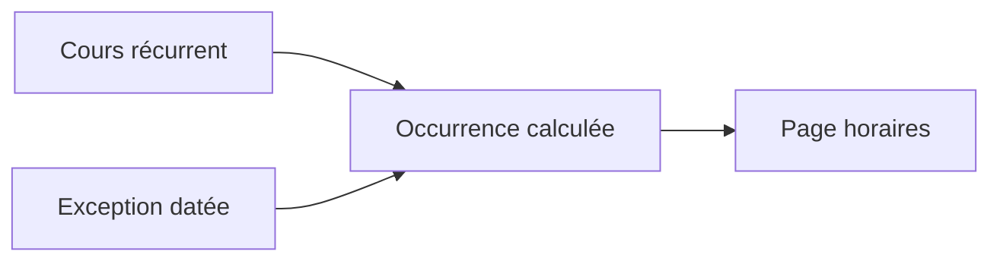
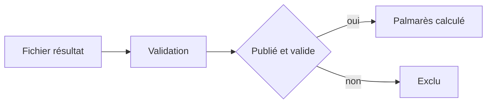

# Architecture technique — Phase 3

## 1. Socle

- Astro en génération statique ;
- TypeScript strict ;
- collections de contenu validées ;
- CSS global fondé sur les tokens validés en Phase 2 ;
- JavaScript client limité au menu, aux filtres et aux formulaires ;
- Vitest pour la logique métier ;
- npm et versions exactes.

Le site public ne dépend d'aucun serveur permanent.

## 2. Données canoniques

Les fichiers de `src/content/` sont la source de vérité publiable. Les faits
sportifs ne sont stockés qu'une fois et les textes localisés vivent dans des
objets portant directement les clés `fr` et `en`.

Valeurs normalisées :

- discipline : `kyorugi` ou `poomsae` ;
- participant : `individual`, `pair` ou `team` ;
- contenu : `draft`, `published`, `archived` ou `cancelled` ;
- médaille : `none`, `bronze`, `silver` ou `gold`.

Le slug public de la discipline Kyorugi reste `/disciplines/combat/` pour
respecter la navigation validée.

## 3. Bilinguisme

Les routes sont générées sous `/fr/` et `/en/`. Un dictionnaire TypeScript
centralise les libellés d'interface. Les helpers de route construisent les
équivalents localisés. Aucune traduction automatique n'est effectuée.

Le domaine cible n'étant pas acquis, les URL canonical utilisent l'origine de
l'environnement de développement. La future URL publique devra être fournie à
Astro seulement après acquisition autorisée du domaine.

## 4. Horaires

Les cours récurrents et leurs exceptions sont séparés :

Une exception peut annuler, déplacer ou modifier une occurrence. Elle ne
réécrit jamais le cours permanent.

## 5. Résultats et palmarès

Le palmarès est calculé au build. Aucun total éditorial n'est stocké. Une
modification conserve l'identifiant du résultat et remplace sa contribution.

## 6. Administration

L'administration cible reste Git-based. `.pages.yml` constitue la
configuration de référence de Phase 3, sans compte ni authentification activés.
Pages CMS est retenu comme base simple uniquement si les cinq administrateurs
acceptent des droits éditoriaux larges.

Si les limites Sport/Éditorial doivent être techniquement imposées, Decap Turbo
Pro avec rôles avancés remplace ce scénario. Les rôles Turbo ne séparent
toutefois que `edit`, `view` et `none` par collection.

Le prototype local `/admin/results/` teste le récapitulatif obligatoire et
l'historique avec `localStorage`. Il n'est ni authentifié, ni synchronisé, ni
relié au CMS. Les comptes, la révocation et la publication Git restent à tester
en Phase 4 après autorisation.

## 7. Sécurité

- aucun secret dans le dépôt ;
- contenu riche sans HTML arbitraire par défaut ;
- schémas stricts et relations vérifiées ;
- site public statique ;
- documents privés hors `public/` et hors Git ;
- formulaire réel désactivé jusqu'au choix d'un fournisseur ;
- audit de dépendances dans les contrôles.

## 8. Hébergement

L'architecture reste compatible avec Cloudflare Pages, GitHub Pages pour la
partie strictement statique et Netlify. Aucune configuration de compte, DNS ou
déploiement n'est exécutée en Phase 3.
